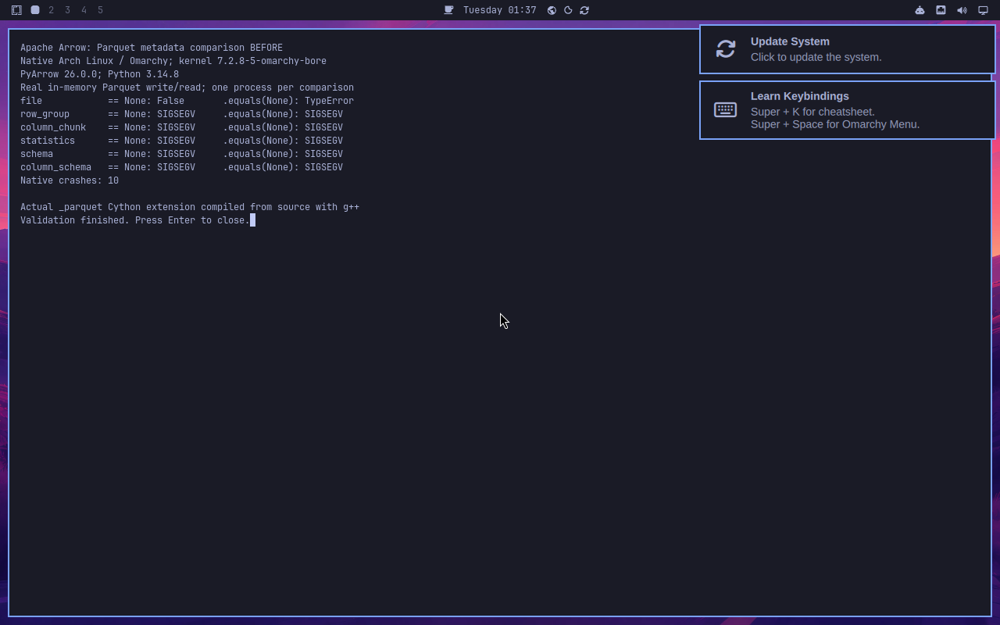
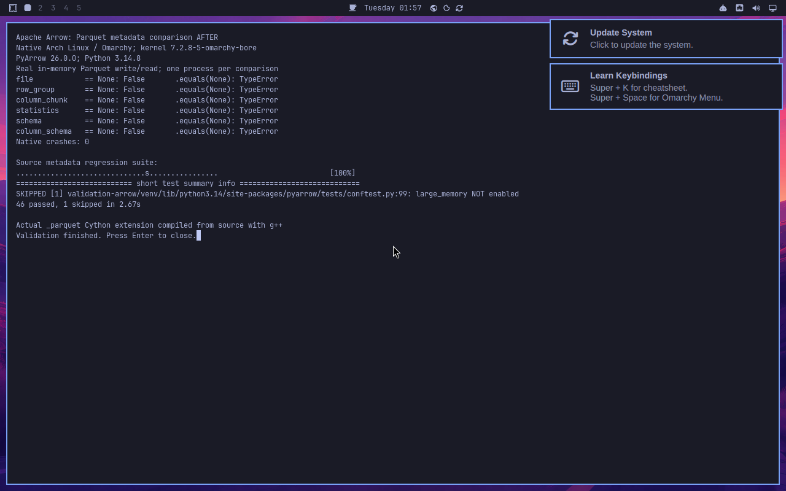

# Arrow Parquet metadata None-comparison validation

Bug: five Parquet metadata/schema equality methods accept None and access native pointers. Standard equality and explicit equals(None) can terminate the process. Issue: https://github.com/apache/arrow/issues/53500.

Candidate source: dc2dbb1465f46aa6a2a73ca3e591c5764f3883da. Base: 9b34c4a6a8856212b885f6a1e934795af04f3192.

## Actual Linux execution

The unmodified and candidate `_parquet` Cython extensions were compiled from source with g++ on Ubuntu (CPython 3.12.14) and inside the official Omarchy/Arch KVM image (CPython 3.14.8). Both link to the unchanged official PyArrow 26.0.0 C++ SDK. All available Cython declaration files match the source; source hashes and ABI checks are in source-and-sdk.json. The C++ SDK libraries were supplied by the release wheels.

Each comparison runs in a fresh Python subprocess with core dumps disabled, after real in-memory Parquet write/read. Ubuntu: eight SIGSEGV results before, zero after. Arch: ten SIGSEGV results before, zero after. FileMetaData is an existing protected control. Valid comparisons are also covered by the regression suite.

## Tests and dependencies

The source test_metadata.py module passes 46 tests on each runtime with S3 explicitly enabled. One existing large-memory test is skipped by upstream default configuration. Official parquet-testing fixtures use commit 56653c437c8092f704a092d0d1d4e600124cd49f. MinIO is installed by Arrow's pinned CI script and verified against its built-in SHA-256. Compatible S3 test dependencies include boto3 1.43.106, aiobotocore 3.9.2 and s3fs 2026.9.0. Each isolated environment passes pip check; full versions and install/build/test logs are included.

Independent read-only AI review found no blocking issue. Generated code and the None guards were reviewed. AI wrote the patch, tests and description; no human-review claim is made.

## Native screenshots

These unmodified full-screen images come from omarchy capture screenshot fullscreen save in the running guest. They show real subprocess exit outcomes and final source test results in foot.

Host paths in text logs are normalized; public release download query strings are omitted. Screenshots and runtime outcomes are unchanged.
